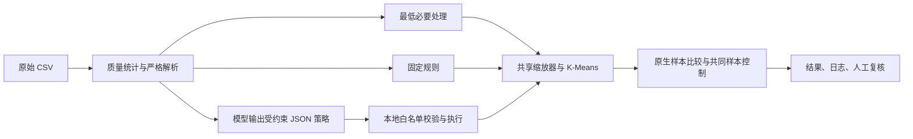

# 项目方法与智能体质量

## 研究问题与交付

研究同一份应用商店数据采用不同质量处理方案后，保留样本与分群结构如何变化。交付包含可追溯的数据处理流程、三组对照、共同样本控制比较、真实模型调用日志、三次补充稳定性实验和人工复核。

处理对象是历史采集记录。应用名称不是可靠唯一 ID，不能把重复名称直接当成同一个应用；这里的分群也不是实时市场结论或因果解释。

## 处理流程

智能体读取质量统计和少量缺失/特殊状态样例，给出三个决策及理由。`deduplicate` 只能是布尔值，`rating`、`size` 只能从 `drop / global_median / category_median` 中选择。程序验证 JSON 后调用预先编写的工具；模型不能直接执行任意代码。结构校验失败时最多再请求一次，已保存的四次真实运行均一次通过。

这是一次规划、受约束执行的智能体流程，没有基于聚类结果反复优化的反馈闭环，也没有多智能体协作。

## 三组策略

| 环节 | 最低必要处理 | 固定规则 | 主实验智能体 |
| --- | --- | --- | --- |
| 单位解析、错位隔离 | 三组相同 | 三组相同 | 三组相同 |
| 完全重复多余记录 | 保留 | 去除 | 去除 |
| 评分缺失 | 排除聚类 | 全局中位数 | 排除聚类 |
| 大小缺失或随设备变化 | 排除聚类 | 全局中位数 | 类别中位数 |

`drop` 表示保留清洗档案、排除聚类，不能写成把原始记录全部删除。类别中位数要求同类别至少 20 个有效观测，否则回退全局中位数。填补值只是建模代理，原始缺失状态和填补标志仍保留。

## 数据质量与字段

原始数据有 1,474 个评分缺失，其中 878 条评论数大于 0；这不说明我们知道其真实评分。还存在 483 条完全重复的多余记录、1 条核心字段错位记录、1,695 条 `Varies with device` 大小状态。合法的高评论数、高安装档位和高价格记录保留，不按“数值大”直接删除。

| 字段 | 含义与处理 |
| --- | --- |
| App / Category | 展示名称 / 商店类别；名称不作唯一键，类别用于画像和可选填补 |
| Rating | 0–5 评分；原始观测与建模代理分别保留 |
| Reviews | 非负整数评论量；进入聚类 |
| Size | `M` 按 MB，`k` 按 0.001 MB；特殊状态单列标记 |
| Installs | 去逗号和 `+` 得到档位下界，不能视为精确安装量 |
| Price / Type | 美元价格进入聚类；Free/Paid 用于一致性核查 |
| Content Rating / Genres | 年龄分级与流派，保留原值作解释 |
| Last Updated | 解析为 ISO 日期，报告解析失败 |
| Current Ver / Android Ver | 保留版本文本及缺失 |

`source_row_id` 是从 1 开始的数据记录序号；错位记录 ID 为 10473，不等同于含表头的显示行号。`rating_observed / size_mb_observed` 表示观测，`rating_value / size_mb` 表示建模值，`*_imputed` 表示是否填补，`eligible_for_clustering / cluster_exclusion_reason` 解释聚类去留。

## 聚类和比较口径

五个特征为评分、评论数、大小、安装档位下界、价格。除评分外先做 `log1p`；共享缩放器在去重且特征完整的 7,424 条参考记录上拟合，避免每组重新缩放造成口径变化。

原生比较各自使用可聚类样本，在 `k=2…6` 中选择轮廓系数最高者。固定 `seed=42`、`n_init=10`、`max_iter=300`、`tol=1e-4`，限制单线程；轮廓系数最多抽取 1,500 条，DB 和 CH 另行报告。参数见[主实验清单](../results/final/run_manifest.json)。

共同样本比较固定 7,424 条记录和 `k=4`，检验三组在相同输入上的结构；另用种子 42、52、62 检查聚类初始化变化。三组共同特征最大差为 0，组间 ARI 为 1；种子 42 与 52 的 ARI 为 1，与 62 约为 0.997952。这类算法稳定性与多次模型决策稳定性是两个问题。

主实验智能体有 8,892 条参与聚类，比最低必要处理净多 1,163 条；净变化同时包含去重和大小代理填补，不能全部归因于填补。三簇可按画像解释为较大规模免费、较小规模免费和付费记录；命名属于描述性概括，应结合[簇画像](../results/final/agent/cluster_profiles.csv)和[代表记录](../results/final/agent/representative_apps.csv)阅读。

## 如何评价智能体

| 维度 | 证据与当前判断 |
| --- | --- |
| 可执行性 | 主实验及三次补充均有真实响应与通过校验的计划；本地工具有边界约束 |
| 可追溯性 | 保存原始数据哈希、核心源码哈希、请求响应、行级变化、隔离与填补标志 |
| 规则合理性 | 已完成 12 条、三组共 36 个处理结果的人工复核，12 条均判为合理；仅覆盖选定案例 |
| 决策稳定性 | 补充 n=3：去重和评分策略 3/3 相同；大小策略 2 次 drop、1 次类别中位数 |
| 解释一致性 | 补充第 3 次大小理由前后矛盾，JSON 可执行不代表文字解释可靠 |
| 填补准确性 | 未提供真值或遮蔽实验，不能声称中位数恢复了真实大小/评分 |
| 分群改善 | 原生样本组成不同；共同样本结果相同，尚不足以证明智能体发现了更好结构 |

后续可做的工作是：用观测值遮蔽实验估计填补误差，增加独立模型调用次数，以及对模型理由与执行策略做语义一致性检查。人工复核和三次稳定性实验已完成，不再列为待做事项。
